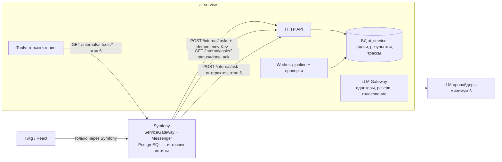

# ТЗ: ИИ-сервис Ваш Финдир (Python)

30 октября 2026 · Павел Новиков

Редакция 2 (30.10.2026): ТЗ приведено к реальной структуре репозитория —
`services/`, `services/_contracts/`, шлюз `ServiceGateway`, pull-модель
(`services/AGENTS.md`, `docs/architecture/service-gateway.md`).

## 1. Цель и границы

ИИ-сервис — отдельный Python-сервис `services/ai-service/` в монорепо. Он
выполняет ИИ-задачи для Symfony-приложения (`site/`) и никогда не является
источником финансовых цифр.

**Что делает:**

- подсказывает статью ДДС для банковских операций, которые не распознали
  автоправила Cash;
- извлекает данные из документов: выписки, отчёты маркетплейсов, акты;
- пишет комментарии к отчётам на основе переданных ему цифр;
- отвечает на вопросы клиента о его данных через инструменты только для чтения.

**Чего не делает:**

- не хранит бизнес-данные клиентов: источник истины — Symfony и его PostgreSQL;
- не считает финансовые показатели: остатки, ОПиУ, ДДС, маржу считает PHP;
- не ходит в БД Symfony и не пишет в неё;
- не общается с пользователем напрямую: фронт (Twig + React) ходит только в
  Symfony;
- не выполняет действий с последствиями: применяет результат (проставляет
  статью и т. п.) только Symfony своим Action.

## 2. Принципы, обязательные с первого дня

1. **Числа только из кода.** LLM получает цифры во входе задачи или через
   инструменты и не вычисляет их сама.
2. **Каждый ответ структурирован.** Выход модели — JSON по Pydantic-схеме,
   невалидный ответ не уходит дальше.
3. **Каждый ответ проверен до выдачи.** Результат всегда несёт вердикт:
   `accepted`, `needs_review` или `rejected`.
4. **Сервис не владеет бизнес-данными.** Собственная БД — только задачи,
   результаты для идемпотентности и трассы с ограниченным сроком хранения.
5. **Модели за абстракцией, моделей несколько.** Провайдер, модель и режим
   (одна модель, резерв, голосование) — конфиг задачи, а не код.
6. **Промпты — версионируемые файлы в репозитории.** Версия промпта пишется в
   каждую трассу.
7. **Одна ИИ-функция = одна задача** со своим контрактом, промптом, проверками
   и eval-набором.
8. **Изоляция клиентов.** Каждая задача несёт `company_id`; инструменты
   получают компанию от Symfony по `task_id`, а не от модели.
9. **Асинхронно по умолчанию.** Синхронно — только короткие интерактивные
   запросы.
10. **Сначала подсказки, потом автоприменение.** Новая задача стартует в
    режиме подсказок; автоприменение включается по компании после
    подтверждённой точности (§6).

## 3. Место в монорепо

Сервис живёт по общим правилам `services/AGENTS.md`; со стороны Symfony —
по `docs/architecture/service-gateway.md` (Symfony — единственный шлюз).
Ни один сервис не импортирует код другого, связь — только через контракты.

```text
/
├── site/                          # Symfony + Twig + React — источник истины
│   └── src/ServiceGateway/        # клиент ai-service, как у ozon-fetcher
├── services/
│   ├── AGENTS.md                  # общие правила сервисов
│   ├── python.md                  # правила Python (создаётся в этапе 1)
│   ├── _contracts/
│   │   ├── ai-task/v1/            # конверт задачи и результата
│   │   └── ai-categorize-transactions/v1/   # вход/выход задачи
│   └── ai-service/
├── docker-compose.yml             # dev, профиль services
├── Makefile                       # make ai-service-*
└── ARCHITECTURE.md                # раздел ServiceGateway, таблица ADR
```

Контракт — каталог `v<N>/` со `schema.json` и `CHANGELOG.md`; опубликованная
версия неизменна (`services/_contracts/README.md`).

Внутри сервиса одна папка в `tasks/` — одна ИИ-функция:

```text
services/ai-service/
├── AGENTS.md
├── README.md
├── pyproject.toml                 # uv, lock-файл
├── docker/Dockerfile
├── migrations/                    # forward-only, прогон явный
├── src/ai_service/
│   ├── api/                       # HTTP, тонкий слой
│   ├── worker/                    # берёт задачи из своей таблицы
│   ├── tasks/
│   │   └── categorize_transactions/
│   │       ├── task.py            # сборка пайплайна задачи
│   │       ├── schemas.py         # вход/выход (Pydantic)
│   │       ├── checks.py          # проверки этой задачи
│   │       └── prompts/v1.md
│   ├── core/pipeline.py           # общий скелет выполнения
│   ├── llm/                       # gateway и адаптеры провайдеров
│   ├── verification/              # общие проверки
│   ├── tools/                     # инструменты для LLM, только чтение (этап 5)
│   ├── privacy/                   # маскирование ПДн
│   ├── tracing/
│   └── config.py
├── evals/
│   └── categorize_transactions/cases.jsonl
└── tests/
```

**Правила монорепо:**

- контракт меняется в `services/_contracts/`; типы с обеих сторон пишутся
  вручную и проверяются тестом контракта на фикстурах (как у ozon-fetcher),
  без кодогенерации;
- CI запускает тесты и evals сервиса только при изменениях в
  `services/ai-service/` или `services/_contracts/ai-*`;
- у сервиса свой Dockerfile и свой цикл релиза; dev — профиль `services` в
  корневом `docker-compose.yml`, таргеты `make ai-service-build`, `-up`,
  `-test`, `-migrate`;
- архитектурные решения — строкой в таблице ADR `ARCHITECTURE.md`.

## 4. Контракт с Symfony

Схема — стандартная для сервисов (`service-gateway.md` §2.7, pull-модель
`services/AGENTS.md` §3): Symfony ставит команду по HTTP с `Idempotency-Key`,
сервис хранит очередь в своей БД, Symfony забирает готовые результаты.
Общей Redis-очереди и межъязыкового Messenger нет.



**Каналы:**

| Канал | Направление | Когда |
| --- | --- | --- |
| `POST /internal/tasks` | Symfony → ИИ | Постановка задачи; `Idempotency-Key`, ответ `202` + `task_id` только после записи в БД |
| `GET /internal/tasks/{id}` | Symfony → ИИ | Статус одной задачи |
| `GET /internal/tasks?status=done` + `POST /internal/tasks/ack` | Symfony → ИИ | Забор готовых результатов постранично, затем подтверждение |
| `POST /internal/ask` | Symfony → ИИ | Интерактивный вопрос клиента, таймаут до 30 с (этап 5) |
| `GET /internal/ai-tools/*` | ИИ → Symfony | Данные клиента для инструментов LLM (этап 5) |
| `GET /health`, `/ready`, `/internal/status` | Symfony → ИИ | Стандартные endpoint'ы сервиса |

**Сторона Symfony:**

- клиент сервиса — в `ServiceGateway` (таймауты, повтор только безопасных
  запросов, единые ошибки `service_unavailable` / `service_timeout` /
  `contract_violation`);
- постановка — Message на транспорте `async_sync` (внешний HTTP); импорт
  результатов — cron + Message на `async_pipeline`;
- хранение подсказок и применение результата — в модуле-потребителе (для
  категоризации — Cash), идемпотентно по `task_id`;
- переключатель `AI_SERVICE_ENABLED` и allowlist компаний; при выключенном
  сервисе задачи ждут, интерфейс работает без подсказок.

**Конверт задачи** (`ai-task/v1`):

```json
{
  "task_id": "uuid",
  "task_type": "categorize_transactions",
  "contract_version": "v1",
  "company_id": "uuid",
  "idempotency_key": "string",
  "requested_by": "user_id | system",
  "created_at": "ISO-8601",
  "trace_id": "uuid",
  "payload": {}
}
```

**Конверт результата:**

```json
{
  "task_id": "uuid",
  "status": "accepted | needs_review | rejected | failed",
  "output": {},
  "checks": [{"name": "category_in_tree", "passed": true, "severity": "block", "details": ""}],
  "confidence": 0.93,
  "trace_id": "uuid",
  "models": ["provider/model-id"],
  "prompt_version": "categorize_transactions/v1",
  "usage": {"input_tokens": 0, "output_tokens": 0}
}
```

**Обязательные правила контракта:**

- деньги — десятичные строки + `currency` (`services/AGENTS.md` §1.3);
- повтор задачи с тем же `idempotency_key` возвращает прежний результат, а не
  новый вызов LLM (unique в БД сервиса);
- `failed` — техническая ошибка, задача остаётся человеку;
- результат, не прошедший проверку схемы на стороне Symfony, —
  `contract_violation`, а не тихо принятые данные;
- токены раздельные по направлениям («Symfony → сервис» и «сервис → Symfony»),
  значения — только env / GitHub secrets;
- `trace_id` передаётся заголовком и пишется в логи обеих сторон.

## 5. Внутренние паттерны

Ядро — общий пайплайн, через который проходит любая задача. Новая ИИ-функция
добавляется новой папкой в `tasks/` без правок ядра.

**Пайплайн задачи (одинаков для всех):**

1. `prepare` — проверка входа, маскирование ПДн, сбор контекста.
2. `generate` — вызов модели (или нескольких) через LLM Gateway.
3. `parse` — разбор ответа в Pydantic-модель, при ошибке один повтор.
4. `verify` — цепочка проверок: общие плюс проверки задачи.
5. `decide` — вердикт по результатам проверок и порогу уверенности.
6. `finalize` — запись результата и трассы. Обратная подстановка ПДн — только
   в задачах, которые пишут текст (с этапа 4).

**Паттерны ядра:**

| Паттерн | Что даёт | Как выглядит |
| --- | --- | --- |
| Task + реестр | Новая функция не трогает ядро | Класс `Task[In, Out]` регистрируется по `task_type` |
| Pipeline | Ни одна задача не обходит проверки | Шаги задаются композицией, а не наследованием |
| LLM Gateway (порт/адаптер) | Смена и комбинация моделей конфигом | Задачи не импортируют SDK провайдеров; в gateway ретраи, таймауты, лимиты, учёт токенов, режимы `single`/`fallback`/`vote` |
| Check | Проверки переиспользуются и тестируются отдельно | Функция `(input, output, context) → CheckResult` с уровнем `block`, `review` или `info` |
| Tool | LLM не выходит за данные клиента | Типизированная функция только на чтение; компанию определяет Symfony по `task_id` |
| Prompt registry | Известно, какой промпт дал ответ | Файл с id и версией, версия попадает в трассу |

Зависимости передаются через конструктор, без DI-фреймворка. Настройки — из
переменных окружения через `pydantic-settings`.

### 5.1. Несколько моделей (минимум три)

- **Адаптер — на семейство API, а не на провайдера.** Один адаптер
  OpenAI-совместимого API покрывает нескольких провайдеров и self-hosted
  модели (vLLM, Ollama); отдельные адаптеры — только для провайдеров со своим
  API (Anthropic SDK, российские модели). Конкретные провайдеры — открытый
  вопрос (§12), в коде не зашиты.
- **Маршрут — в конфиге задачи:**

  ```yaml
  categorize_transactions:
    mode: fallback        # single | fallback | vote
    models: [provider_a/model, provider_b/model, provider_c/model]
  ```

  - `fallback` (по умолчанию) — при ошибке или таймауте берётся следующая
    модель;
  - `vote` — все модели получают одну задачу; согласие 2 из 3 → `accepted`,
    иначе `needs_review`. Втрое дороже, включается только для рискованных
    задач и заменяет отдельную self-consistency.
- **Теневой прогон:** в период подсказок вторая модель может работать на тех
  же задачах без показа клиенту — данные для выбора основной модели копятся.
- Маскирование ПДн одинаково для всех провайдеров; модель каждого вызова — в
  трассе. Список разрешённых провайдеров по компании (152-ФЗ) — фильтр
  маршрута, включается по запросу клиента.

## 6. Контур качества и защита от галлюцинаций

Проверки подбираются под задачу. В MVP (категоризация) — четыре дешёвые
детерминированные проверки; остальные включаются на своих этапах.

| Проверка | Что ловит | При провале | Этап |
| --- | --- | --- | --- |
| Схема (Pydantic) | Невалидный ответ | Повтор, затем `rejected` | MVP |
| Статья из справочника компании | Выдуманная или чужая статья ДДС | `rejected` | MVP |
| Полнота ответа | Входная операция без ответа или с двумя ответами | `rejected` | MVP |
| Порог уверенности | Сомнительная классификация | `needs_review` | MVP |
| Финансовые инварианты | Сумма по статьям ≠ итогу, извлечённые суммы ≠ контрольным | `rejected` | Документы |
| Происхождение чисел | Число в тексте, которого нет во входе или в инструментах | `rejected` | Комментарии |
| Голосование моделей | Расхождение моделей (`mode: vote`) | `needs_review` | По задаче |
| Ссылки на источник | Утверждение без фрагмента-источника в RAG-ответе | `needs_review` | С RAG |
| LLM-as-judge | Утверждения, не подтверждённые контекстом | `needs_review` | Для рискованных задач |

**Режим подсказок и автоприменение:**

- новая задача стартует в режиме подсказок: результат показывается человеку,
  он принимает или исправляет; каждое решение пишется в Symfony как метка
  точности;
- автоприменение включается флагом **по компании** при двух условиях: не
  меньше N решений человека и точность за последние 4 недели не ниже порога
  (числа — §12);
- автоприменяется только `accepted`; статья, проставленная человеком, не
  перезаписывается никогда; у автоприменённой статьи видна пометка «ИИ» и
  быстрый откат;
- флаг выключается — задача возвращается в режим подсказок.

**Уровни риска задаются в описании задачи:**

- **низкий** — категоризация операций: автоприменение возможно после периода
  подсказок, выборочный аудит;
- **средний** — комментарии к отчётам: показываются с пометкой
  «сгенерировано ИИ»;
- **высокий** — налоги и рекомендации по деньгам: только черновик для
  финдира, всегда `needs_review`.

Промпты всех задач явно разрешают ответ «недостаточно данных». Для извлечения
и классификации — temperature 0.

**Связь с автоправилами Cash.** ИИ получает только операции, которые не
распознали автоправила. Если ИИ видит повторяющийся шаблон (контрагент,
подстрока назначения), он может предложить автоправило; после утверждения
человеком такие операции категоризирует детерминированный код без LLM.

## 7. Безопасность и данные

Персональные данные не покидают периметр в открытом виде, а содержимое
документов никогда не трактуется как инструкция.

- **Маскирование ПДн до вызова модели.** ФИО, номера счетов, телефоны, ИНН
  физлиц заменяются токенами. Таблица подстановки живёт только в памяти на
  время задачи; в MVP маскирование одностороннее.
- **Защита от prompt injection.** Текст из выписок, PDF и назначений платежей
  передаётся в отдельном блоке данных. У модели нет инструментов с побочными
  эффектами.
- **Минимум прав.** Сервис доступен только во внутренней docker-сети, без
  traefik-роутера. Инструменты — только `GET`, компания определяется
  Symfony по `task_id`.
- **Трассы хранят только замаскированные данные**, срок — 30 дней. Удаление
  компании в Symfony запускает удаление её трасс.
- **Логи** — без токенов, ПДн, сырых ответов моделей и финансовых значений
  (`services/AGENTS.md` §6).
- **Секреты** — только env / GitHub secrets, в репозитории — имена переменных.

## 8. Хранение, наблюдаемость и evals

**БД сервиса:** отдельная база `ai_service` на текущем PostgreSQL, отдельная
роль `svc_ai_service` с правами только на неё; база и роль создаются деплоем
(как у ozon-fetcher). Миграции forward-only, прогон явный
(`make ai-service-migrate`). Таблицы:

- `ai_task` — очередь и статусы, unique по `idempotency_key`; worker берёт
  задачи через `FOR UPDATE SKIP LOCKED`, зависшие возвращаются по таймауту;
- `ai_result` — результат для идемпотентности и выдачи Symfony, после `ack`
  обнуляется `output`;
- `ai_trace` — трасса, TTL 30 дней.

Трассы содержат суммы и замаскированные назначения — это исключение из
`services/AGENTS.md` §9 («без денег, сумм, ПДн»); исключение для ai-service
фиксируется в §9 в этапе 1.

**Трасса задачи:**

- `task_id`, `task_type`, `company_id`, `trace_id`;
- вход в замаскированном виде, версия промпта, модель каждого вызова,
  параметры;
- вызовы инструментов и их ответы;
- сырой ответ модели, результаты каждой проверки, вердикт;
- задержка, токены.

Решение человека (принял / исправил) хранится в Symfony — отдельный
feedback-endpoint в сервисе не нужен. Стоимость в рублях считает отчёт по
токенам.

**Наблюдаемость:** structlog в JSON, `trace_id` из заголовка Symfony, свой
проект в GlitchTip (только ERROR), строка в `/internal/status`.

**Evals:**

- у каждой задачи `evals/<task>/cases.jsonl`: обезличенные кейсы с правильным
  ответом плюс «ловушки», где правильный ответ — «недостаточно данных»;
- первый набор категоризации — из истории: операции, которым человек вручную
  проставил статью ДДС; выгружает консольная команда Symfony, перед коммитом
  — обезличивание;
- запуск через pytest, у задачи — пороги метрик;
- evals гоняются по каждой модели маршрута: таблица «модель × точность ×
  стоимость × задержка» — основание для выбора основной модели;
- PR, меняющий промпт, модель или проверки, проходит только при пройденных
  порогах; исправления пользователей раз в неделю пополняют набор.

**Метрики:** доля `accepted` / `needs_review` / `rejected`, точность по
решениям людей (по компании и по модели), срабатывания проверок, задержка,
токены на клиента в месяц.

## 9. Стек

Минимальный, без тяжёлых ИИ-фреймворков.

| Область | Выбор | Почему |
| --- | --- | --- |
| Язык и пакеты | Python 3.12, uv | Быстрая установка, lock-файл |
| HTTP | FastAPI | Схемы из Pydantic |
| Модели данных | Pydantic v2 | Контракты, structured output, валидация |
| Очередь | Таблица `ai_task` в БД сервиса | Без новой инфраструктуры; как `fetch_task` у ozon-fetcher |
| LLM | Официальные SDK / OpenAI-совместимый HTTP за собственным gateway | Без привязки к фреймворку, минимум 3 модели |
| Хранилище | PostgreSQL: база `ai_service`, роль `svc_ai_service`; pgvector — когда понадобится RAG | Без нового инстанса |
| Качество кода | pytest, ruff, mypy — правила в `services/python.md` | Стандарт |
| Логи | structlog (JSON), `trace_id` заголовком | Как у остальных сервисов |
| Поставка | Docker, профиль `services` | Как ozon-fetcher |

## 10. Правила развития

**Делаем всегда:**

1. Новая ИИ-функция = новая задача с контрактом, промптом, проверками и
   минимум 20 eval-кейсами. Без eval-набора в прод не идёт.
2. PR с изменением промпта или модели содержит результаты evals до и после.
3. Контракт меняется только новой версией (`v1` → `v2`). Старая живёт, пока
   Symfony не мигрирует.
4. Изменение ядра (pipeline, gateway, verification) — строка в таблице ADR
   `ARCHITECTURE.md`.
5. У каждой задачи есть уровень риска; новая задача стартует в режиме
   подсказок.

**Не делаем, пока evals не докажут необходимость:**

- агентные и multi-agent фреймворки, LangChain-подобные обёртки;
- отдельную векторную БД;
- fine-tuning собственных моделей;
- внутренние микросервисы внутри ИИ-сервиса.

**Не делаем никогда:**

- финансовые расчёты в Python — они живут в PHP;
- инструменты для LLM с записью или побочными эффектами;
- зависимость Symfony от доступности ИИ-сервиса.

## 11. Объём MVP и этапы

Переход к следующему этапу — по достижении порогов качества, а не по
календарю.

0. **Расчистка** — два отдельных PR до каркаса:
   - **удаление `site/src/Ai`** (прототип `CashflowAgent` с TODO, ничего не
     делает): сначала read-only на проде — число строк в `ai_agent`,
     `ai_run`, `ai_suggestion` и обращения к `/ai/suggestions`; затем удалить
     `src/Ai`, `templates/ai`, `tests/Unit/Ai`, `tests/Integration/Ai`, блок
     в `config/routes.yaml`, маппинг в `config/packages/doctrine.yaml`,
     пункт меню, env `LlmClient`, команду `RunCashflowAgentsCommand` и её
     cron, раздел `ARCHITECTURE.md` (+ Changelog), записи baseline PHPStan.
     Таблицы пустые — `DROP` миграцией в том же PR; с данными — выгрузка в
     CSV, необратимая миграция явно указывается в запросе «merge and deploy»;
   - **удаление `site/src/Mcp`** (локальная stdio-заглушка, не работает):
     `src/Mcp`, `docs/mcp/`, тесты `Unit/Mcp`, `Integration/Mcp`; методы
     `CashFacade`, нужные только MCP (`upsertCashflowCategory` и др.,
     `CashFacadeMcpSurfaceTest`), — удалить, если grep не находит других
     потребителей. Инструменты этапа 5 проектируются заново поверх Facade.
1. **Каркас.** `services/python.md`, контракты `ai-task/v1`, API задач,
   таблица-очередь, pipeline, LLM Gateway с тремя адаптерами и режимом
   `fallback`, маскирование ПДн, трассы, исключение в `services/AGENTS.md`
   §9, клиент в `ServiceGateway`, переключатель и allowlist, CI с evals.
   Задача-заглушка проходит путь Symfony → сервис → Symfony. Вынос в
   прод-compose — отдельное одобрение (`AGENTS.md` §3.3).
2. **Категоризация операций.** 100+ eval-кейсов из истории, справочник статей
   ДДС компании во входе, только операции без автоправила, режим подсказок в
   UI, сравнение моделей; автоприменение — флагом по компании после порогов
   §6; предложение автоправил.
3. **Разбор документов.** Отчёты маркетплейсов и выписки, проверка
   инвариантов и сверка с банковскими поступлениями.
4. **Комментарии к отчётам.** Генерация по цифрам из входа с проверкой
   происхождения чисел, обратная подстановка ПДн.
5. **Вопросы клиента.** `POST /internal/ask`, инструменты `GET
   /internal/ai-tools/*`; LLM-as-judge и RAG — если evals покажут
   необходимость.

## 12. Открытые вопросы

Решено 30.10.2026: очередь — таблица в БД сервиса; БД — отдельная база и роль
на текущем PostgreSQL; автоприменение — после периода подсказок; моделей —
минимум три; модули `Ai` и `Mcp` удаляются; золотой набор — из истории ручных
категоризаций.

- [ ] Какие три провайдера и модели на старте; есть ли клиенты, которым нужна
  только российская или self-hosted модель.
- [ ] N решений человека и порог точности для включения автоприменения.
- [ ] Допустимый бюджет на LLM на одного клиента в месяц.
