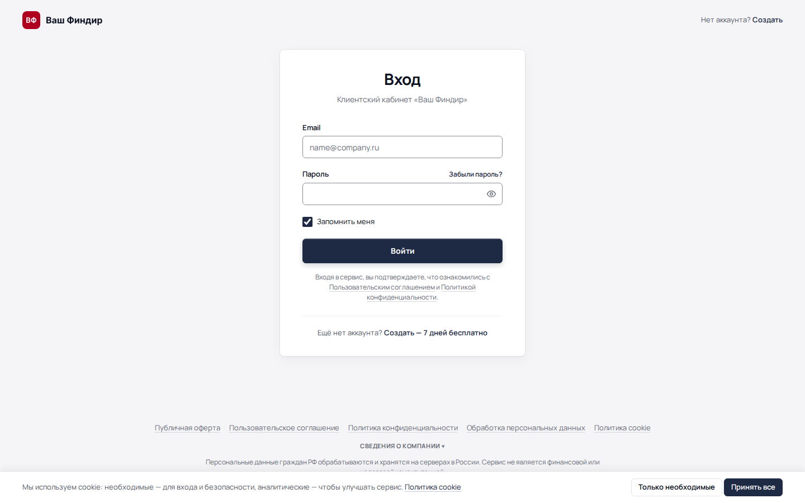
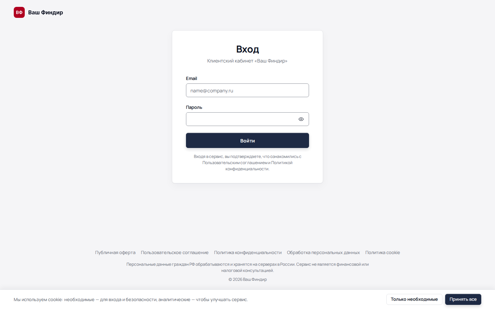
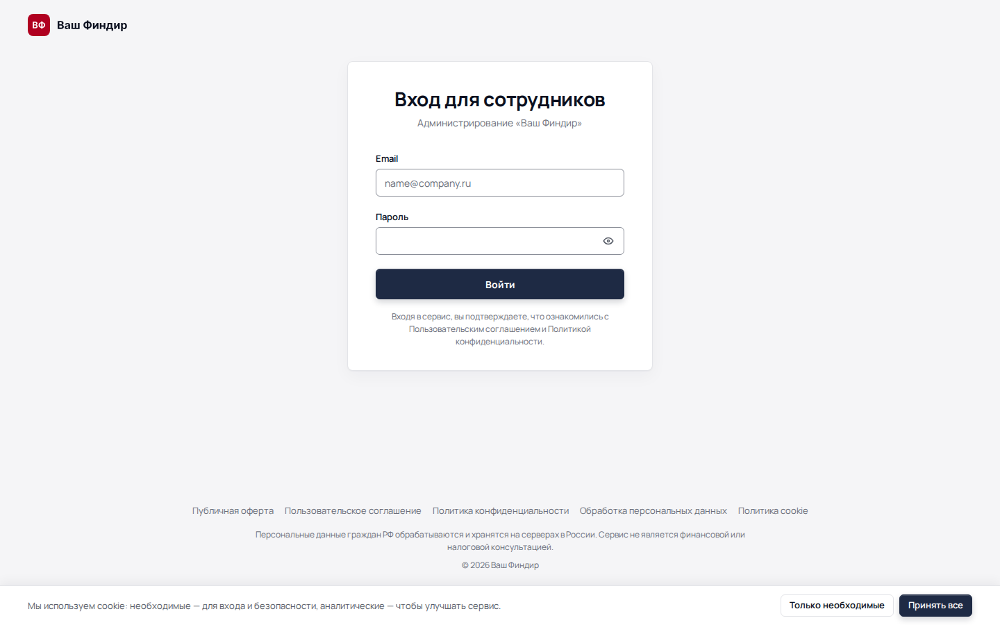
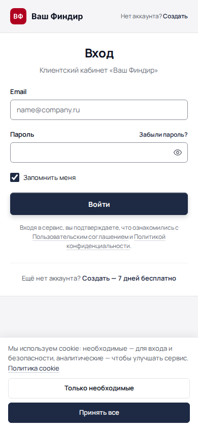
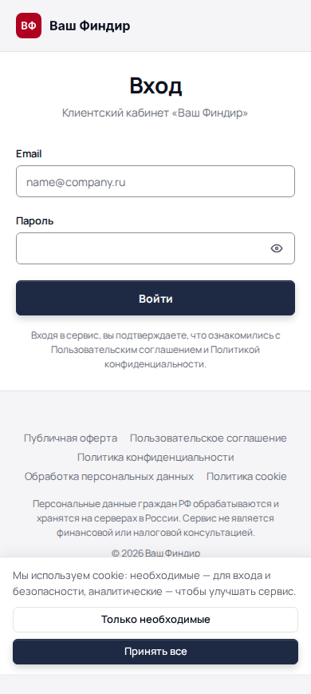
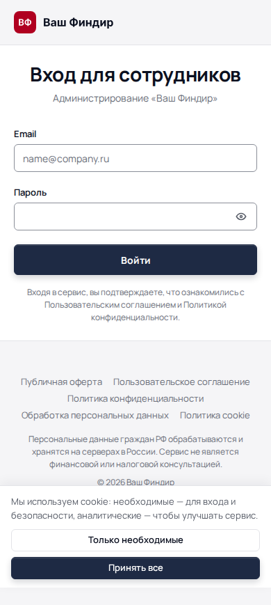

# Визуальная приёмка входа v3.4

Эталон — `docs/design-system/v3/screens/Login.html` из #3022. Скриншоты источника
сняты в масштабе 1 CSS px с локальным Manrope; исходный DOM/CSS не исправлялся.
Скриншоты продукта — Chromium preview, ширины 1440 и 390, `scale: css`.

| Ширина | Эталон | Account | Admin |
|---|---|---|---|
| 1440 |  |  |  |
| 390 |  |  |  |

Без cookie: [account1440](artifacts/account-login-default-1440.png),
[account390](artifacts/account-login-default-390.png),
[admin1440](artifacts/admin-login-default-1440.png),
[admin390](artifacts/admin-login-default-390.png).
Ошибки: [account](artifacts/account-login-error-desktop.png),
[admin](artifacts/admin-login-error-desktop.png).
Компании: [desktop](artifacts/account-companies-desktop.png),
[390](artifacts/account-companies-mobile.png).

## Сверка и намеренные отклонения

- Совпадают header/logo32, карточки440/520, hero28/34, поля40/text14, глаз32/icon18,
  primary44, отступы карточки, desktop shadow, mobile square/no-shadow, cookie32.
- Таблица источника главнее иллюстративного CSS: на390 заголовок28 (иллюстрация24),
  cookie-кнопки32 (иллюстрация40). Footer присутствует и на390 по таблице, хотя
  мобильный demo DOM его опускает. Поэтому мобильная страница может прокручиваться.
- Форма короче demo: API не поддерживает remember, SPA не имеет forgot/signup URL.
  Оба signup блока и divider скрыты; мёртвых ссылок нет.
- Юридические документы — обычный текст. Реквизиты/свёрнутый блок скрыты до передачи
  конфигурации в apps. Copyright содержит известный бренд, без выдуманной организации.
- Ошибочная рамка использует `--ds-danger-text`: исходный `danger-dot` даёт2.80:1,
  ниже необходимых3:1; сохранено существующее доступное решение DS.
- Company rows без ИНН/роли (нет полей API), active_company предвыбран на видимой
  странице. Долговременный last-used API не гарантирует; поиск — по текущей странице,
  что явно подписано при наличии пагинации.
- Cookie находится в потоке sticky: подвал можно прочитать прокруткой; demo использует
  absolute поверх footer. Analytics в apps отсутствует, загрузчики не добавлялись.

## Доступность и доказательства

Измеренный минимум text4.682:1, input border3.280:1. Playwright проверяет
text/placeholder ≥4.5:1, input border≥3:1, outline2px у каждого
из семи интерактивных элементов (password ring на InputGroup), отсутствие overflow,
cookie180дней/SameSite=Lax/event и обе ширины/приложения. Числа —
[acceptance-metrics.json](artifacts/acceptance-metrics.json).

Полный preview: account29 + admin25 + DS components48 passed (10 conditional skips:
production-only и desktop-only случаи). После финальных review fixes выполнен
focused login/company прогон; точные результаты в handoff.md.
